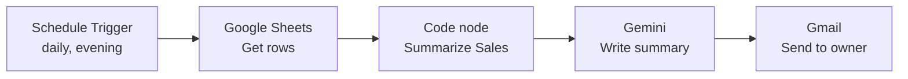

# Daily Sales Summary (n8n)

A small n8n automation for a coffee shop (or any small business). Every evening it reads the day's sales from a Google Sheet, calculates the totals, has Google Gemini write a short, friendly summary, and emails it to the owner.

## How it works



1. **Schedule Trigger** starts the workflow once a day at closing time.
2. **Google Sheets** reads every row from the `Daily Sales` sheet.
3. **Code node** keeps only today's rows and calculates the number of sales entries, total sales, top-selling item, and a per-item breakdown.
4. **Basic LLM Chain + Gemini** turns those numbers into a short summary with one practical suggestion.
5. **Gmail** emails the summary, plus the total and top item, to the owner.

## Sheet format

Create a Google Sheet named **Daily Sales** with these headers in row 1. Format the `date` column as plain text so dates stay as `yyyy-mm-dd`.

| date | item | quantity | price |
| --- | --- | --- | --- |
| 2026-11-02 | Iced Latte | 3 | 120 |
| 2026-11-02 | Cappuccino | 2 | 110 |

## Sample output of the Code node

For the sample data, the Code node returns:

```json
{
  "date": "2026-11-02",
  "orders": 6,
  "totalSales": 5095,
  "topItem": "Smores",
  "itemsSummary": "Smores: 10, Matcha Latte: 5, Croissant: 4, Iced Latte: 3, Cappuccino: 2, Churros: 2"
}
```

Gemini then writes the email text from these values.

## Setup

1. Run n8n (`n8n`) and create credentials for **Google Sheets OAuth2**, **Gmail OAuth2**, and **Google Gemini API**.
2. Import `workflows/daily-sales-summary.json`.
3. Select your credentials in the Google Sheets, Gemini, and Gmail nodes.
4. In the Google Sheets node, choose your **Daily Sales** document and sheet.
5. In the Gmail node, set the **To** address.
6. Set the workflow **Timezone** in its settings, so "today" and the schedule use local time.
7. Click **Execute workflow** to test, then **Publish** to run it on schedule.

> n8n only runs scheduled workflows while it is running. For a real client, host it on n8n Cloud or a small server.

## Tech

n8n, Google Sheets API, Gmail API, Google Gemini, JavaScript (Code node)

## Possible improvements

- Compare today's total with yesterday's or last week's average
- Report revenue per item, not just quantity sold
- Send the summary to Telegram or Slack as well as email
- Weekly report with a chart
- Connect to a real POS export instead of manual sheet entry

## Project structure

```
.
├── README.md
├── workflows/
│   └── daily-sales-summary.json
└── screenshots/
    ├── workflow-canvas.png
    ├── sales-sheet.png
    └── summary-email.png
```
